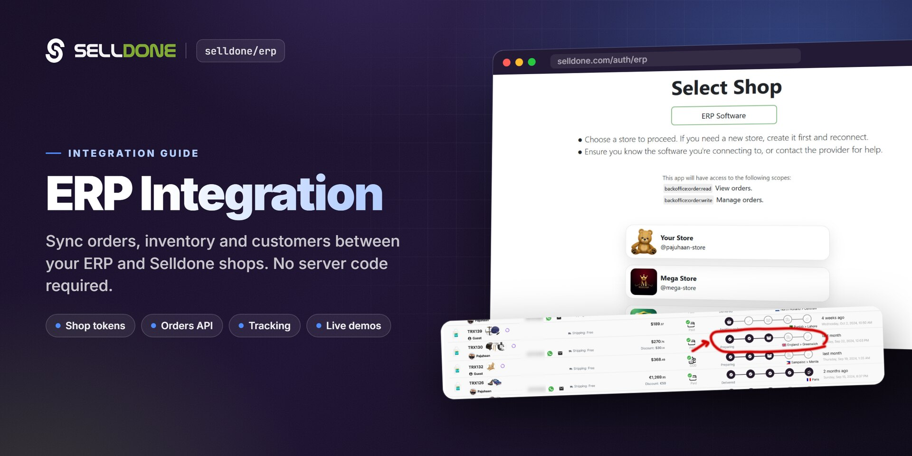
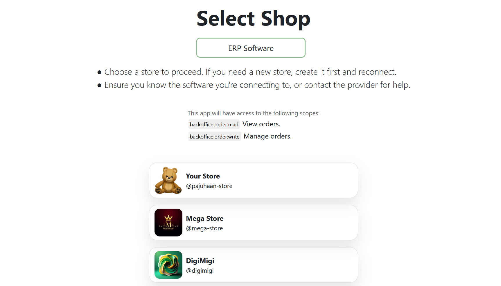
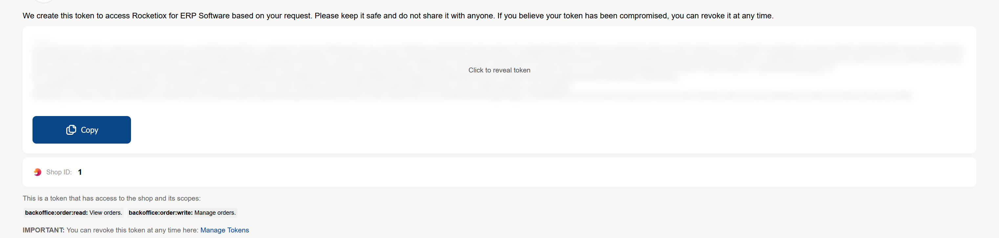
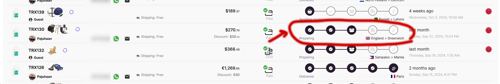

<p align="center">
  
</p>

<p align="center">
  <a href="LICENSE"></a>
  <a href="https://github.com/selldone/erp/wiki"></a>
  <a href="https://selldone.com"></a>
</p>

<p align="center">
  <b>A guide and live demos for connecting ERP software to Selldone shops: fetch orders, update fulfillment and set tracking.</b><br>
  <a href="https://github.com/selldone/erp/wiki">Documentation</a> ·
  <a href="#quick-start">Quick start</a> ·
  <a href="https://github.com/selldone">Ecosystem</a> ·
  <a href="https://selldone.com">Selldone.com</a> ·
  <a href="https://github.com/selldone/erp/issues">Report an issue</a>
</p>

<p align="center">
  <a href="https://github.com/selldone/storefront">Storefront</a> ·
  <a href="https://github.com/selldone/pagebuilder">Page Builder</a> ·
  <a href="https://github.com/selldone/components">Components</a> ·
  <a href="https://github.com/selldone/storefront-sdk">Storefront SDK</a> ·
  <a href="https://github.com/selldone/backoffice-sdk">Backoffice SDK</a> ·
  <a href="https://github.com/selldone/vendor-sdk">Vendor SDK</a> ·
  <a href="https://github.com/selldone/community-sdk">Community SDK</a> ·
  <a href="https://github.com/selldone/core">Core</a> ·
  <a href="https://github.com/selldone/cli">CLI</a> ·
  <a href="https://github.com/selldone/translate">Translate</a>
</p>

## Overview

This repository shows how to integrate ERP software with shops on **Selldone® Business OS**, so the ERP can manage
orders efficiently: read paid physical orders, move them through the fulfillment steps and attach shipment tracking
details.

ERP software often runs on local machines, so it cannot rely on server-side code or a hosted OAuth callback. Instead,
the shop owner creates a **personal token for each shop** with a single link. The ERP then calls the Selldone REST API
directly with that token. Tokens are scoped, and the owner can view and revoke them at any time.

The repository contains this guide, a [detailed order data reference](response-structure.md) and three small HTML demo
pages that run in the browser and call the real API. Use it if you build or maintain an ERP, accounting, warehouse or
fulfillment integration for Selldone merchants.

- Demo video (How it works): [demo.selldone.com](https://demo.selldone.com/demo/cm2yjk5sh32o9esgv6ckru79r)
- Live demos: [Fetch orders](https://selldone.github.io/erp/orders-list.html) ·
  [Update order](https://selldone.github.io/erp/order-update-state.html) ·
  [Set order tracking](https://selldone.github.io/erp/order-set-tracking.html)

[](https://youtu.be/60bsxi1BUAA)

## Key features

- **No server needed** — a personal, per-shop token lets desktop and on-premise ERP software call the API directly.
- **Scoped access** — request only the scopes you need, such as `backoffice:order:read` and `backoffice:order:write`.
- **Localized token pages** — the token link works on localized domains such as `zh.selldone.com`.
- **Fetch physical orders** — paginated (up to 250 per request), filterable by status, product, affiliate and customer.
- **Incremental sync** — pass `updated_at` to fetch only orders that changed since your last sync.
- **Fulfillment updates** — move orders through `OrderConfirm`, `PreparingOrder`, `SentOrder` and `ToCustomer`.
- **Partial confirmation** — confirm only the items you can fulfill so the merchant knows what to refund.
- **Tracking and returns** — set a tracking code and URL, or report a failed delivery that came back.
- **Live demos** — three dependency-free HTML pages you can run on GitHub Pages or locally.
- **Full data reference** — every order, item, product and variant field explained.

## Screenshots

| Select a shop | Copy the token |
|---|---|
|  |  |



## Quick start

**1. Create a token.** While logged in to Selldone, open:

```text
https://selldone.com/auth/erp?scopes[]=selldone:identification&scopes[]=backoffice:shop:read&scopes[]=backoffice:order:read&scopes[]=backoffice:order:write&scopes[]=backoffice:product:read&scopes[]=backoffice:category:read
```

Select your shop, then copy the token and note the shop ID.

**2. Fetch the latest paid physical orders.**

```bash
curl -g "https://api.selldone.com/shops/{shop-id-here}/process-center/baskets-PHYSICAL?offset=0&limit=10&sortDesc=true&statuses[]=Payed&with[]=items&with[]=buyer&with[]=products" \
     -H "Authorization: Bearer <token>" \
     -H "Accept: application/json"
```

(`-g` stops curl from treating the `[]` in the query string as a pattern.)

**3. Or try it in the browser** with the [Fetch Orders Demo](https://selldone.github.io/erp/orders-list.html): enter
the shop ID and token and click **Fetch Orders**.

## Usage

### Token generation

#### Step 1: Select shop

**Important:** The user must be logged in to Selldone.

Create a link with the following format:

```
https://selldone.com/auth/erp?scopes[]=selldone:identification&scopes[]=backoffice:shop:read&scopes[]=backoffice:order:read&scopes[]=backoffice:order:write&scopes[]=backoffice:product:read&scopes[]=backoffice:category:read
```

Localized URLs are supported:

```
https://zh.selldone.com/auth/erp?scopes[]=backoffice:order:read&scopes[]=backoffice:order:write
```

When the user accesses this link, they can select their shop from the page:


#### Step 2: Token generation

After selecting the shop, the user will be redirected to a page displaying the token:


#### Managing tokens

You can view and revoke created tokens by visiting
[https://selldone.com/developer/access](https://selldone.com/developer/access).

### API: Get orders

To fetch orders from a Selldone shop, send a `GET` request to the following endpoint:

```
https://api.selldone.com/shops/{shop-id-here}/process-center/baskets-PHYSICAL?offset=0&limit=10&sortDesc=true&statuses[]=Payed&with[]=items&with[]=buyer&with[]=products
```

Replace `{shop-id-here}` with the actual shop ID. Send the token as `Authorization: Bearer <token>`.

This endpoint returns a list of `PHYSICAL` orders with full details. The maximum `limit` is **250**.

#### Order types

For ERP systems, you typically need to work with **physical** (goods) orders. Selldone supports various order types,
including:

| Type | Notes |
|---|---|
| `PHYSICAL` | ERPs work only with this type. |
| `FILE` | |
| `SERVICE` | |
| `VIRTUAL` | |
| `SUBSCRIPTION` | |

#### Response structure

The response contains two main fields:

- `orders`: An array of orders.
- `total`: The total number of orders.

By default, the endpoint returns the most recent orders first. You can sort the results by adding `sortBy=reserved_at`
and `sortDesc=false` to the query string.

#### Query parameters

The endpoint accepts the following query parameters:

- **`offset`** *(integer, min: 0)*: The starting point of records.
- **`limit`** *(integer, min: 1, max: 250)*: The number of records to return.
- **`sortBy`** *(string, optional)*: The field to sort by (e.g., `reserved_at`).
- **`sortDesc`** *(boolean, optional)*: Whether to sort in descending order.
- **`statuses`** *(array of strings, optional)*: The order statuses to filter by. Valid values are `Open`, `Reserved`,
  `Payed`, `Canceled`, `COD`. If not provided, `Payed` and `COD` are considered by default.
- **`product_id`** *(integer, optional)*: Filter orders containing a specific product.
- **`affiliate_id`** *(integer, optional)*: Filter orders associated with a specific affiliate.
- **`customer_id`** *(integer, optional)*: Filter orders placed by a specific customer.
- **`with`** *(array of strings, optional)*: Include related data. Valid values are `items`, `buyer`, `connect_orders`,
  `products`, `payment`.

#### Synchronizing orders

To synchronize orders without fetching all orders every time, use the `updated_at` query parameter. Send the last sync
date as a timestamp (integer), and the endpoint will return orders updated after this date.

#### Order structure

Below is an overview of the important parameters returned in the order data, which are critical for ERP software
integration:

| **Parameter** | **Description** |
|---|---|
| **Order ID (`id`)** | Unique identifier for the order, used for tracking and managing orders. |
| **Customer ID (`customer_id`)** | Unique identifier for the customer placing the order. |
| **Order Type (`type`)** | Type of order (e.g., `PHYSICAL`, `SERVICE`), determining the fulfillment process. |
| **Order Status (`status`)** | Current status of the order. Possible values: `Open`, `Reserved`, `Payed`, `Canceled`, `COD`. Since we are fetching `Payed` orders, this value will be `Payed`. |
| **Order Price (`price`)** | Total price of the order. |
| **Currency (`currency`)** | Currency used in the order. |
| **Delivery Price (`delivery_price`)** | Cost of delivering the order to the customer. |
| **Delivery State (`delivery_state`)** | Current state of the delivery process. Possible values: `CheckQueue`, `OrderConfirm`, `PreparingOrder`, `SentOrder`, `ToCustomer`. |
| **Receiver Information (`receiver_info`)** | Information about the recipient for fulfilling the delivery. This includes: <br/> - **Name (`name`)**: Name of the recipient. <br/> - **Phone (`phone`)**: Phone number of the recipient. <br/> - **Address (`address`)**: Full delivery address. <br/> - **City, State, Country**: Location details for shipment. <br/> - **Postal Code (`postal`)**: Postal/ZIP code. <br/> - **Location (`location`)**: GPS coordinates for precise delivery. |
| **Items (`items`)** | List of items within the order, essential for inventory and fulfillment. Each item includes: <br/> - **Item ID (`id`)**: Unique identifier of the item in the order. <br/> - **Product ID (`product_id`)**: Identifier of the product being ordered. <br/> - **Variant ID (`variant_id`)**: Identifier of the product variant, if applicable. <br/> - **Quantity (`count`)**: Number of units ordered. <br/> - **Price (`price`)**: Price of each item. <br/> - **Currency (`currency`)**: Currency used for item pricing. |
| **Product Information (`product`)** | Details about the product, including: <br/> - **SKU (`sku`)**: Stock Keeping Unit for inventory tracking. <br/> - **MPN (`mpn`)**: Manufacturer Part Number for product identification. (If the product has multiple variants, refer to `variant.sku` and `variant.mpn`.) |
| **Variant Information (`variant`)** | Details about the product variant, if applicable. Includes: <br/> - **SKU (`sku`)**: Variant-specific SKU. <br/> - **MPN (`mpn`)**: Variant-specific MPN. |
| **Buyer Information (`buyer`)** | Information about the buyer (can be `null` if it's a guest shop). Includes: <br/> - **Name (`name`)**: Name of the buyer. <br/> - **Email (`email`)**: Email address for communication. <br/> - **Phone (`phone`)**: Phone number of the buyer. |
| **Checkout Date (`reserved_at`)** | Timestamp of when the order was checked out. |

**[More details about the response structure](response-structure.md)** (also in the
[wiki](https://github.com/selldone/erp/wiki/Response-Structure)).

Test it: **[Fetch Orders Demo](https://selldone.github.io/erp/orders-list.html)**.

### API: Update order

This section explains how to update order statuses with the Selldone API. It outlines the steps of order fulfillment
and how to communicate these updates through API calls.

#### Updating order status

You can update the status of orders by sending a `POST` request to the following endpoint:

```plaintext
https://api.selldone.com/shops/{shop-id-here}/process-center/baskets/{order-id-here}/state
```

Replace `{shop-id-here}` with your actual shop ID and `{order-id-here}` with the specific order ID.


Selldone defines 5 steps in the order fulfillment process (`CheckQueue`, `OrderConfirm`, `PreparingOrder`,
`SentOrder`, `ToCustomer`), which you can manage by updating the `delivery_state` parameter. Each state should be
called sequentially after the previous one.

##### 1. Confirm order (`OrderConfirm`)

This step indicates that the order has been reviewed and confirmed.

**Parameters:**

- `state`: `OrderConfirm`
- `list`: An array of `item.id`s that are confirmed. If you cannot fulfill an item, do not include its ID in this list.
  This helps the merchant understand how much to refund to the buyer in the Selldone panel. `null` means all items are
  confirmed.

```bash
curl -X POST "https://api.selldone.com/shops/12345/process-center/baskets/67890/state" \
     -H "Content-Type: application/json" \
     -H "Authorization: Bearer abcdef123456" \
     -d '{
           "state": "OrderConfirm",
           "list": [23990, 23991]
         }'
```

Response 200:

```json
{
  "delivery_state": "OrderConfirm",
  "updated": 2,
  "changed": true,
  "items": [
    {
      "id": 23990,
      "basket_id": 15002,
      "product_id": 2346,
      "variant_id": null,
      ...
    },
    ...
  ]
}
```

##### 2. Prepare order (`PreparingOrder`)

At this stage, you set packaging information and indicate that the order is ready to ship (e.g., ready for courier
pickup).

**Parameters:**

- `state`: `PreparingOrder`
- `delivery_info`: If there are no changes to `delivery_info`, send the original `order.delivery_info` in this
  parameter. `null` means no changes.

```bash
curl -X POST "https://api.selldone.com/shops/12345/process-center/baskets/67890/state" \
     -H "Content-Type: application/json" \
     -H "Authorization: Bearer abcdef123456" \
     -d '{
           "state": "PreparingOrder",
           "list": null,
           "delivery_info": {
             "distance": 11312.99,
             "volume": {
               "width": 0,
               "length": 0,
               "height": 0
             },
             "weight": 0,
             "days": ["Sunday", "Monday", "Tuesday", "Wednesday", "Thursday", "Saturday"],
             "time_spans": ["Morning", "Evening"],
             "custom": false,
             "type": "Cargo",
             "connect_delivery": 0,
             "inbound_delivery": 2,
             "outbound_delivery": 0,
             "vendor_delivery": 0,
             "date": null
           }
         }'
```

Response 200:

```json
{
  "delivery_state": "PreparingOrder",
  "changed": true
}
```

##### 3. Send order (`SentOrder`)

Use this when the order has been shipped (e.g., handed over to DHL).

**Parameters:**

- `state`: `SentOrder`

```bash
curl -X POST "https://api.selldone.com/shops/12345/process-center/baskets/67890/state" \
     -H "Content-Type: application/json" \
     -H "Authorization: Bearer abcdef123456" \
     -d '{
           "state": "SentOrder",
           "list": null,
           "delivery_info": null
         }'
```

Response 200:

```json
{
  "delivery_state": "SentOrder",
  "changed": true
}
```

##### 4. Deliver to customer (`ToCustomer`)

(Optional) This step indicates that the buyer has received their order.

**Parameters:**

- `state`: `ToCustomer`

```bash
curl -X POST "https://api.selldone.com/shops/12345/process-center/baskets/67890/state" \
     -H "Content-Type: application/json" \
     -H "Authorization: Bearer abcdef123456" \
     -d '{
           "state": "ToCustomer",
           "list": null,
           "delivery_info": null
         }'
```

Response 200:

```json
{
  "delivery_state": "ToCustomer",
  "delivery_at": "2024-10-31T15:32:07.000000Z",
  "changed": true
}
```

Test it: **[Update Order Demo](https://selldone.github.io/erp/order-update-state.html)**.

##### Shipping failed and order returned

If the shipping fails and the order is returned, send a `POST` request to the following endpoint:

```plaintext
https://api.selldone.com/shops/{shop-id-here}/process-center/baskets/{order-id-here}/delivery-returned
```

##### Important notes

- **Sequential updates:** Each state should be called after the previous state. For example, you should only send
  `SentOrder` if `PreparingOrder` has already been called.
- **ERP limitations:** If your ERP system does not support multi-step fulfillment processes, you can create multiple API
  calls in a series to update the order status to the final state.

### API: Set tracking information

You can set the tracking code and URL for the order by sending a `PUT` request to:

```plaintext
https://api.selldone.com/shops/{shop-id-here}/process-center/baskets/{order-id-here}/tracking
```

**Parameters:**

- `tracking_code` (optional): The tracking code of the order (any string).
- `tracking_url` (optional): The tracking URL of the order (must be a valid URL).

```bash
curl -X PUT "https://api.selldone.com/shops/12345/process-center/baskets/67890/tracking" \
     -H "Content-Type: application/json" \
     -H "Accept: application/json" \
     -H "Authorization: Bearer abcdef123456" \
     -d '{
           "tracking_code": "1Z999AA10123456784",
           "tracking_url": "https://example.com/track/1Z999AA10123456784"
         }'
```

Test it: **[Set Order Tracking Demo](https://selldone.github.io/erp/order-set-tracking.html)**.

### Selldone authentication scopes

Add each scope your integration needs as a `scopes[]` parameter of the token link.

<details>
<summary>Show all scopes</summary>

| Scope                               | Description                   |
|-------------------------------------|-------------------------------|
| `backoffice:order:read`             | Read orders                   |
| `backoffice:order:write`            | Modify orders                 |
| `backoffice:support-tickets`        | Access support tickets        |
| `backoffice:shop:read`              | Read shop details             |
| `backoffice:shop:write`             | Modify shop details           |
| `backoffice:shop:add`               | Add a new shop                |
| `backoffice:shop:delete`            | Delete a shop                 |
| `backoffice:giftcard:write`         | Create/edit gift cards        |
| `backoffice:giftcard:read`          | Read gift cards               |
| `backoffice:faq:write`              | Create/edit FAQ entries       |
| `backoffice:faq:read`               | Read FAQ entries              |
| `backoffice:category:write`         | Create/edit categories        |
| `backoffice:category:read`          | Read categories               |
| `backoffice:product:write`          | Create/edit products          |
| `backoffice:product:read`           | Read products                 |
| `backoffice:report:read`            | Read reports                  |
| `backoffice:finance:write`          | Manage financial records      |
| `backoffice:finance:read`           | Read financial records        |
| `backoffice:page:write`             | Create/edit pages             |
| `backoffice:page:read`              | Read pages                    |
| `backoffice:logistic:write`         | Manage logistics              |
| `backoffice:logistic:read`          | Read logistics details        |
| `backoffice:staff:write`            | Manage staff accounts         |
| `backoffice:staff:read`             | Read staff details            |
| `backoffice:business-profile:write` | Edit business profile         |
| `backoffice:business-profile:read`  | Read business profile         |
| `backoffice:discount-code:write`    | Manage discount codes         |
| `backoffice:discount-code:read`     | Read discount codes           |
| `backoffice:wallet:write`           | Manage user wallets/accounts  |
| `backoffice:wallet:read`            | Read user wallets/accounts    |
| `backoffice:notifications`          | Access notifications          |
| `backoffice:coupon:write`           | Manage coupons                |
| `backoffice:coupon:read`            | Read coupons                  |
| `backoffice:offer:write`            | Manage offers                 |
| `backoffice:offer:read`             | Read offers                   |
| `backoffice:cashback:write`         | Manage cashback programs      |
| `backoffice:cashback:read`          | Read cashback programs        |
| `backoffice:lottery:write`          | Manage lottery programs       |
| `backoffice:lottery:read`           | Read lottery programs         |
| `backoffice:community:write`        | Manage community posts        |
| `backoffice:community:read`         | Read community posts          |
| `backoffice:customer:write`         | Manage customer data          |
| `backoffice:customer:read`          | Read customer data            |
| `backoffice:ribbon:write`           | Manage ribbons                |
| `backoffice:ribbon:read`            | Read ribbons                  |
| `backoffice:ai:write`               | Manage AI settings            |
| `backoffice:ai:read`                | Read AI settings              |
| `backoffice:vendor-payment:write`   | Manage vendor payments        |
| `backoffice:vendor-payment:read`    | Read vendor payments          |
| `backoffice:company:write`          | Manage company data           |
| `backoffice:company:read`           | Read company data             |
| `backoffice:note:write`             | Manage notes                  |
| `backoffice:note:read`              | Read notes                    |
| `backoffice:affiliate:write`        | Manage affiliates             |
| `backoffice:affiliate:read`         | Read affiliates               |
| `backoffice:print:write`            | Manage print-related settings |
| `backoffice:print:read`             | Read print-related settings   |
| `backoffice:reviews:write`          | Manage reviews                |
| `backoffice:reviews:read`           | Read reviews                  |
| `backoffice:property-set:write`     | Manage property sets          |
| `backoffice:property-set:read`      | Read property sets            |

</details>

### Demos

The repository is published with GitHub Pages at [selldone.github.io/erp](https://selldone.github.io/erp/). Each demo
is a single HTML file (Bootstrap 5 from a CDN plus [`helper.js`](helper.js)) that calls the API from your browser.

| Demo | File | Calls |
|---|---|---|
| [Fetch Orders](https://selldone.github.io/erp/orders-list.html) | [`orders-list.html`](orders-list.html) | `GET .../process-center/baskets-PHYSICAL` |
| [Update Order](https://selldone.github.io/erp/order-update-state.html) | [`order-update-state.html`](order-update-state.html) | `POST .../process-center/baskets/{order}/state` |
| [Set Order Tracking](https://selldone.github.io/erp/order-set-tracking.html) | [`order-set-tracking.html`](order-set-tracking.html) | `PUT .../process-center/baskets/{order}/tracking` |

The update and tracking pages read `shopId` and `orderId` from the query string, and the orders list links to them for
each order. To run them locally, open the HTML files in a browser.

## Documentation

| Page | What you'll learn |
|---|---|
| [Home](https://github.com/selldone/erp/wiki) | What this integration guide covers. |
| [Getting Started](https://github.com/selldone/erp/wiki/Getting-Started) | Create a token and make your first API call. |
| [Token Generation](https://github.com/selldone/erp/wiki/Token-Generation) | Build the token link, choose scopes and manage tokens. |
| [Orders API](https://github.com/selldone/erp/wiki/Orders-API) | Fetch, filter, paginate and incrementally sync orders. |
| [Order Statuses](https://github.com/selldone/erp/wiki/Order-Statuses) | Move orders through the fulfillment states and handle returns. |
| [Tracking](https://github.com/selldone/erp/wiki/Tracking) | Set a tracking code and tracking URL. |
| [Response Structure](https://github.com/selldone/erp/wiki/Response-Structure) | Every order, item, product and variant field. |
| [Demos](https://github.com/selldone/erp/wiki/Demos) | Use and run the HTML demo pages. |
| [FAQ](https://github.com/selldone/erp/wiki/FAQ) | Common questions and troubleshooting. |

## How it fits in the ecosystem

ERP integrations use the same shop-admin API (`api`) that powers the Selldone dashboard and the
[Backoffice SDK](https://github.com/selldone/backoffice-sdk). This repository focuses on the order endpoints an ERP
needs and on a token flow that works without a server. For bulk data, see the [Excel templates](https://github.com/selldone/excel)
for imports and [Clone Sheet](https://github.com/selldone/clone-sheet) for copying shop data into your own database.

<a href="https://github.com/selldone#ecosystem">
  
</a>

### Related projects

| Project | Why it matters here |
|---|---|
| [Backoffice SDK](https://github.com/selldone/backoffice-sdk) | Admin API client (`window.$backoffice`) for custom dashboards and integrations. |
| [Clone Sheet](https://github.com/selldone/clone-sheet) | Clone shop data (products, customers, orders) into MariaDB/MySQL with the same token flow. |
| [Excel](https://github.com/selldone/excel) | Excel templates for bulk import of products, categories, customers and more. |
| [Core](https://github.com/selldone/core) | Shared models, types, enums and helpers. |
| [GPT](https://github.com/selldone/gpt) | OpenAPI 3.1 schema and guide to build a custom GPT for Selldone. |

## Contributing

Contributions are welcome. Please read the organization
[contributing guide](https://github.com/selldone/.github/blob/main/CONTRIBUTING.md) and
[code of conduct](https://github.com/selldone/.github/blob/main/CODE_OF_CONDUCT.md). The demos are plain HTML files with
no build step: edit them and open them in a browser to test.

## Security

Please do not report security vulnerabilities in public issues. Follow the
[Selldone security policy](https://github.com/selldone/.github/blob/main/SECURITY.md) and email
[security@selldone.com](mailto:security@selldone.com). Treat ERP tokens like passwords: store them securely and revoke
unused tokens at [selldone.com/developer/access](https://selldone.com/developer/access).

## License

This repository is licensed under the GNU General Public License v3.0. See the [LICENSE](LICENSE) file for the full text.

---
<p align="center"><sub>Part of the <a href="https://github.com/selldone">Selldone® Business OS</a> open-source ecosystem · <a href="https://selldone.com">selldone.com</a></sub></p>
